<picture>
  <source media="(prefers-color-scheme: dark)" srcset="docs/assets/banner-dark.svg">
  
</picture>

[](https://status.useyuva.com/prodid)
[](https://www.npmjs.com/package/prodid)
[](spec/)

A barcode is not a product. prodid gives every physical product a permanent open identifier, resolves
every barcode and part number to it, and keeps every fact as a claim that names its source.

**[prodid.org](https://prodid.org)** · [Specification](spec/README.md) ·
[Publish your products](https://prodid.org/publish) · [Data](https://prodid.org/data)

## Develop

With [Bun](https://bun.sh) 1.4.4 and `bzip2`:

```sh
bun install --frozen-lockfile
bun run check
```

[`ARCHITECTURE.md`](ARCHITECTURE.md) explains the code, [`CONTRIBUTING.md`](CONTRIBUTING.md) how to
contribute, and [`docs/self-hosting.md`](docs/self-hosting.md) how to run an index yourself.

The specification and schemas in [`spec/`](spec/) are CC0; everything else is Apache-2.0.
